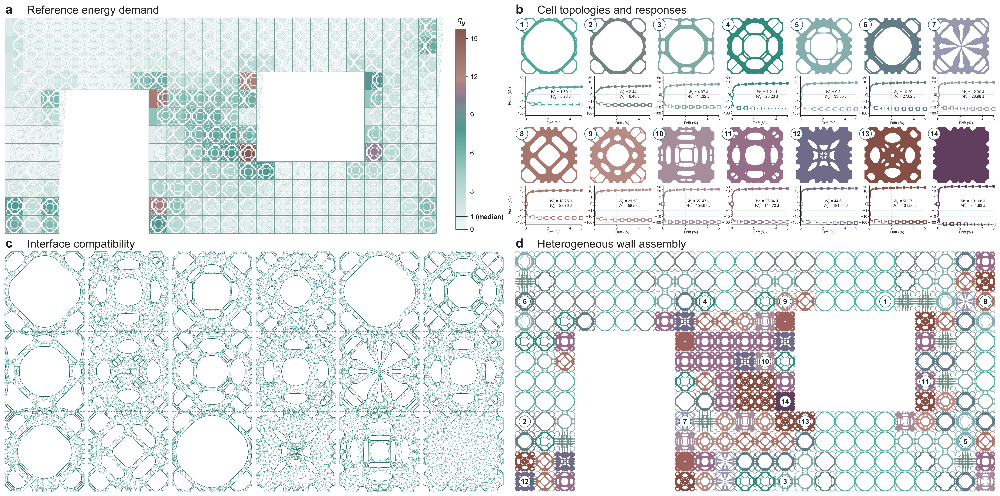
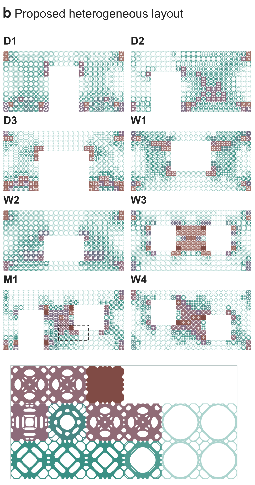

# Nonlinear multiscale design of heterogeneous cellular structures

The design method assigns different cell geometries across a structure by matching their nonlinear loading work to the local mechanical demand. Energy-dissipating walls (EWs) with openings provide an application under cyclic lateral loading.

## Design workflow

1. **Map structural demand.** Use the reference response under the design load history to estimate the spatial distribution of plastic dissipation.
2. **Characterise candidate cells.** Integrate the nonlinear compression and shear force–displacement curves to obtain loading work. Screen cells for compatible edges, material efficiency and complementary mechanical responses.
3. **Assign cells under member-level constraints.** Weight each cell’s compression and shear work by the local loading mode, then match the resulting capacity to regional demand. Constrain the assignment by interface compatibility, total material volume and initial member stiffness.
4. **Assemble and evaluate.** Place the selected cells within the member geometry and evaluate its cyclic response with a detailed solid finite-element model.

## Python implementation

The [design folder](./design/) contains the core Python source for candidate screening, nonlinear compression and shear work, and constrained cell assignment.

| Source | Role |
| --- | --- |
| [Candidate screening](./design/screen_candidates.py) | Match cell interfaces, pair response curves with elastic tensors, and build the screened candidate cache. |
| [Cell assignment](./design/assign_cells.py) | Match regional demand to weighted cell work under material and initial-stiffness constraints. |
| [Assignment refinement](./design/refine_assignment.py) | Swap cell placements using a prior assignment log while preserving the cell inventory and material volume. |
| [Initial compatibility](./design/initial_compatibility.py) and [material motion](./design/material_motion.py) | Evaluate initial in-plane compatibility and local loading directions. |

The Python programs depend on NumPy, SciPy, h5py and Pillow. The screening and assignment commands take explicit `--project`, `--model-store` and `--out` paths. Use `--help` on each script for its other inputs. Running the design from scratch requires the corresponding candidate bank, elastic tensor records and reference demand data. The assignment stage returns a cell map and pixel layout. The prebuilt Abaqus decks below can be used independently.

To restrict cell assignment to measured curve domains, use `--require-native-curves`. The compatibility iteration budget is set with `--max-outer-cuts`.

## Application to walls with openings

These eight layouts use the same 100 mm square cell grid within a 2400 × 1200 mm wall envelope. The figure shows the reference geometry and preserves the openings and cell topology.

## Abaqus input decks

Each ZIP contains one original `.inp` for the proposed heterogeneous design. The decks use six-node solid wedge elements (C3D6) and include the material definitions, boundary conditions and cyclic loading step. Extract the ZIP and use the enclosed `.inp` as the Abaqus input deck.

| Wall | Model ID | Input deck |
| --- | --- | --- |
| D1 | `HE10000` | [D1 INP](./D1-HE10000.zip) |
| D2 | `HE10001` | [D2 INP](./D2-HE10001.zip) |
| D3 | `HE10002` | [D3 INP](./D3-HE10002.zip) |
| W1 | `HE10003` | [W1 INP](./W1-HE10003.zip) |
| W2 | `HE10004` | [W2 INP](./W2-HE10004.zip) |
| W3 | `HE10005` | [W3 INP](./W3-HE10005.zip) |
| M1 | `HE10006` | [M1 INP](./M1-HE10006.zip) |
| W4 | `HE10007` | [W4 INP](./W4-HE10007.zip) |
